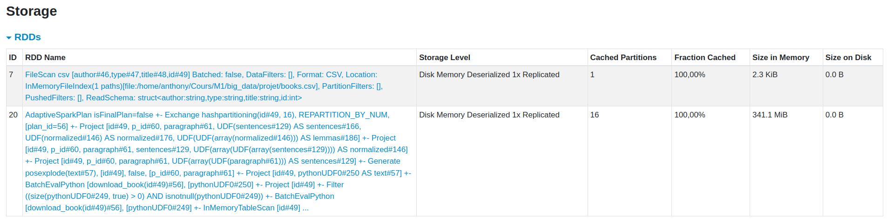




# Extract Load Transform

## Livres choisis

::: {style="font-size: 0.65em;"}
```{python}
#| label: books-table

from pyspark.sql import Window
from IPython.display import Markdown

win = Window.partitionBy("author").orderBy("title")

Markdown(
    books
    .select("author", "title")
    .distinct()
    .withColumn("rank", F.rank().over(win))
    .groupBy("rank")
    .pivot("author")
    .agg(F.coalesce(F.first("title"), F.lit("")))
    .drop("rank")
    .toPandas()
    .to_markdown(index=False)
)
```
:::

## La pipeline

```{python}
#| label: pipeline
#| eval: false
#| echo: true

@F.udf(ArrayType(StringType()))
def download_book(id):
    raw = gutenbergpy.get_text_by_id(id)
    text = gutenbergpy.strip_headers(raw).decode("utf-8").split("\n\n")
    clean = [p.strip().replace("\n", " ") for p in text]
    return [s for s in clean if s]

if dl_books:
    books = spark.read.csv("books.csv", header=True,
                           schema="author STRING, type STRING, title STRING, id INT")
    library = (
        books
        .select("id")
        .withColumn("text", download_book("id"))
        .select("id", F.posexplode("text").alias("p_id", "paragraph"))
    )
    books.write.parquet(str(books_cache))
    library.write.parquet(str(library_cache))
else:
    books = spark.read.parquet(str(books_cache))
    library = spark.read.parquet(str(library_cache))

books = books.persist()
```
# Annotation

## Annotateurs utilisés

- DocumentAssembler
- SentenceDetector
- Tokenizer
- Normalizer
- LemmatizerModel
- Finisher

## Un exemple d'annotation

::: {style="font-size: 0.8em;"}
```{python}
#| label: annotation-example

import pandas as pd
first_row = (
    result
    .select(["paragraph", "sentences", "normalized", "lemmas"])
    .filter(F.size(result.sentences) >= 2)
    .first()
    .asDict()
)
Markdown(pd.DataFrame([first_row]).to_markdown(index=False))
```
:::

# Analyse stylométrique

## Mesures de lisibilité

```{python}
#| label: readability

VOWELS = "aeiouyàâäéèêëîïôöùûüÿœæ"

KM = 207.000 - 1.015 * (F.col("num_words") / F.col("num_sentences")) - 73.6 * (F.col("num_syllables") / F.col("num_words"))
FK = 206.835 - 1.015 * (F.col("num_words") / F.col("num_sentences")) - 84.6 * (F.col("num_syllables") / F.col("num_words"))

def compute_readability(df, *groups):
    return (
        df
        .withColumn(
            "syllables",
            F.aggregate(
                "normalized", F.lit(0),
                lambda acc, word: acc + F.regexp_count(word, F.lit(rf'[{VOWELS}]+'))
            )
        )
        .groupBy("id", *groups)
        .agg(
            F.sum(F.size("sentences")).alias("num_sentences"),
            F.sum(F.size("normalized")).alias("num_words"),
            F.sum("syllables").alias("num_syllables")
        )
        .withColumns({"kandel_moles": KM, "flesch_kincaid": FK})
        .join(F.broadcast(books), on="id")
    )
```

```{python}
#| label: readability-plots

import plotly.express as px

global_readability = (
    compute_readability(result)
    .sort("kandel_moles", ascending=True)
    .toPandas()
)

fig = px.bar(
    global_readability,
    x="title",
    y=["kandel_moles", "flesch_kincaid"], facet_col="variable",
    color="type",
    category_orders={"title": global_readability["title"].tolist()},
    labels={"value": "Indice de lisibilité", "variable": "Indice", "type": "Movement", "title": "Livre"},
    hover_data={"value": ":.2f"}
)
fig.for_each_annotation(lambda a: a.update(text=a.text.split("=")[1]))
fig.update_xaxes(showticklabels=False)
fig.show()
```

. . .

- Kandel-Moles : $207 - 1.015 \times \frac{N_{words}}{N_{sentences}} - \color{red}{73.6} \times \frac{N_{syllables}}{N_{words}}$
- Flesch-Kincaid : $206.835 - 1.015 \times \frac{N_{words}}{N_{sentences}} - \color{red}{84.6} \times \frac{N_{syllables}}{N_{words}}$

# Lisibilité glissante

```{python}
#| label: sliding-readability

def sliding_readability(df, n):
    return compute_readability(
        df.withColumn("g_id", F.floor(F.col("p_id") / F.lit(n))),
        "g_id"
    )

ids = [38971, 39024, 34528, 41211]
selected = result.filter(F.col("id").isin(ids))

sliding_100 = sliding_readability(selected, 100)
sliding_200 = sliding_readability(selected, 200)
```

## Fenêtre de 100 paragraphes

```{python}
#| label: sliding-plots-100

fig = px.bar(
    sliding_100,
    x="g_id",
    y="kandel_moles",
    facet_col="title",
    labels={"g_id": "Fenêtre", "kandel_moles": "Lisibilité", "title": "Livre"},
    hover_data={"kandel_moles": ":.2f"}
)
fig.for_each_annotation(lambda a: a.update(text=a.text.split("=")[1]))
fig.update_xaxes(matches=None)
fig.show()
```

## Fenêtre de 200 paragraphes

```{python}
#| label: sliding-plots-200

fig = px.bar(
    sliding_200,
    x="g_id",
    y="kandel_moles",
    facet_col="title",
    labels={"g_id": "Fenêtre", "kandel_moles": "Lisibilité", "title": "Livre"},
    hover_data={"kandel_moles": ":.2f"}
)
fig.for_each_annotation(lambda a: a.update(text=a.text.split("=")[1]))
fig.update_xaxes(matches=None)
fig.show()
```

# Loi de Zipf

```{python}
#| label: zipf

rank_window = Window.partitionBy("id").orderBy(F.desc("freq"))

zipf = (
    result
    .select("id", F.explode("normalized").alias("word"))
    .groupBy("id", "word")
    .agg(F.count("*").alias("freq"))
    .withColumn("rank", F.row_number().over(rank_window))
    .join(F.broadcast(books.select("id", "title")), on="id")
    .orderBy("title", "rank")
)

fig = px.line(
    zipf.toPandas(),
    x="rank", log_x=True,
    y="freq", log_y=True,
    markers=True,
    animation_frame="title",
    labels={"rank": "Rang", "freq": "Fréquence", "title": "Livre", "word": "Mot"},
    hover_data={"word": True}
)
fig.show()
```

# Utilisation de spark

## Shuffle critiques

- `result.repartition(16, "id").persist()`

  

- (explode + groupBy) & (partitionBy + orderBy) = problèmes
```{python}
#| label: zipf-shuffle
#| eval: false
#| echo: true

rank_window = Window.partitionBy("id").orderBy(F.desc("freq"))

zipf = (
    result
    .select("id", F.explode("normalized").alias("word"))
    .groupBy("id", "word")
    .agg(F.count("*").alias("freq"))
    .withColumn("rank", F.row_number().over(rank_window))
    .join(F.broadcast(books.select("id", "title")), on="id")
    .orderBy("title", "rank")
    )
```

## Cache et persistance

- Première ligne : table `books`
- Deuxième ligne : table `library` (après annotation)



## Comparaison des formats

CSV: inutilisable, pas de colonne de type array

| Format  | Taille sur disque | Temps de lecture | Temps d'écriture |
|---------|-------------------|------------------|------------------|
| Parquet |  91 Mo            | 0.069 ms         | 0.756 ms         |
| JSON    | 213 Mo            | 0.579 ms         | 0.625 ms         |

#
