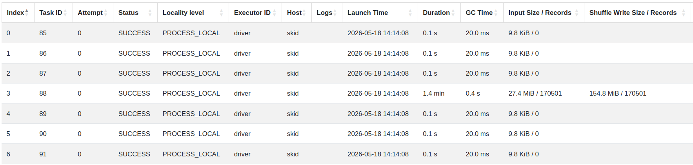




# Stylometric analysis

## Readability indices

We will compute the Kandel-Moles and Flesch-Kincaid readability indices for our books. The formulas are as follows:

- Kandel-Moles : $207 - 1.015 \times \frac{N_{words}}{N_{sentences}} - 73.6 \times \frac{N_{syllables}}{N_{words}}$
- Flesch-Kincaid : $206.835 - 1.015 \times \frac{N_{words}}{N_{sentences}} - 84.6 \times \frac{N_{syllables}}{N_{words}}$

Where $N_{words}$ is the number of words, $N_{sentences}$ is the number of sentences and $N_{syllables}$ is the number of syllables in the text. Higher values indicate easier readability.

```{python}
#| label: readability

VOWELS = "aeiouyàâäéèêëîïôöùûüÿœæ"

KM = 207.000 - 1.015 * (F.col("num_words") / F.col("num_sentences")) - 73.6 * (F.col("num_syllables") / F.col("num_words"))
FK = 206.835 - 1.015 * (F.col("num_words") / F.col("num_sentences")) - 84.6 * (F.col("num_syllables") / F.col("num_words"))

def compute_readability(df, *groups):
    return (
        df
        .withColumn(
            "syllables",
            F.aggregate(
                "normalized", F.lit(0),
                lambda acc, word: acc + F.regexp_count(word, F.lit(rf'[{VOWELS}]+'))
            )
        )
        .groupBy("id", *groups)
        .agg(
            F.sum(F.size("sentences")).alias("num_sentences"),
            F.sum(F.size("normalized")).alias("num_words"),
            F.sum("syllables").alias("num_syllables")
        )
        .withColumns({"kandel_moles": KM, "flesch_kincaid": FK})
        .join(F.broadcast(books), on="id")
    )
```

Here is two barplots showing the Kandel-Moles and Flesch-Kincaid indices for each book, sorted by Kandel-Moles index. We hid the titles since they make the plot less readable, you can see them by hovering over the bars.

```{python}
#| label: readability-plots

import plotly.express as px

global_readability = (
    compute_readability(result)
    .sort("kandel_moles", ascending=True)
    .toPandas()
)

fig = px.bar(
    global_readability,
    x="title",
    y=["kandel_moles", "flesch_kincaid"], facet_col="variable",
    color="type",
    category_orders={"title": global_readability["title"].tolist()},
    title="Readability indices for each book",
    labels={"value": "Readability index", "variable": "Index", "type": "Movement", "title": "Book"},
    hover_data={"value": ":.2f"}
)
fig.for_each_annotation(lambda a: a.update(text=a.text.split("=")[1]))
fig.update_xaxes(showticklabels=False)
fig.show()
```

As we can see, the two indices are highly correlated but the Flesch-Kincaid index is systematically lower than the Kandel-Moles index. Indeed, the Flesch-Kincaid formula is calibrated for English texts and gives a much higher weight to the number of syllables per word. However French naturally tends to have more syllables per word than English which leads every text to be deemed overly difficult to read by the Flesch-Kincaid formula.

Now focusing on the Kandel-Moles index, we notice that 13 out of the 15 easiest books to read are written by romantic authors. This is not surprising as romantic literature is known for its simple and accessible style, often using straightforward language and sentence structures to appeal to a wide audience. On the other hand, the two most difficult books to read are written by authors from the realist movement, which is known for its more complex and detailed writing style.

## Sliding readability indices

We will now compute Kandel-Moles index again but this time on sliding windows of paragraphs instead of the whole book. This will allow us to see how the readability of the text evolves throughout the book and if there are significant variations between different parts of the same book.

Since this is a per novel approach, we will only focus on a subset of 4 novels: the two easiest to read (*La Coucaratcha 1 & 2*) and the two hardest to read (*La Comédie Humaine 1* & *Rome*) according to the Kandel-Moles index computed on the whole book.

```{python}
#| label: sliding-readability

def sliding_readability(df, n):
    return compute_readability(
        df.withColumn("g_id", F.floor(F.col("p_id") / F.lit(n))),
        "g_id"
    )

ids = [38971, 39024, 34528, 41211]
selected = result.filter(F.col("id").isin(ids))

sliding_100 = sliding_readability(selected, 100)
sliding_200 = sliding_readability(selected, 200)
```

First, let's look at the sliding Kandel-Moles index with a window of 100 paragraphs:

```{python}
#| label: sliding-plots-100

fig = px.bar(
    sliding_100,
    x="g_id",
    y="kandel_moles",
    facet_col="title",
    title="Sliding Kandel-Moles index with a window of 100 paragraphs",
    labels={"g_id": "Window ID", "kandel_moles": "Readability", "title": "Book"},
    hover_data={"kandel_moles": ":.2f"}
)
fig.for_each_annotation(lambda a: a.update(text=a.text.split("=")[1]))
fig.update_xaxes(matches=None)
fig.show()
```

The most striking observation is that the Kandel-Moles index is much more volatile when computed on sliding windows than on the whole book. For example, *Rome*, which was graded as the most difficult book to read with a score of 58.33 on the whole book, has some windows with a Kandel-Moles index as low as 50 and as high as 71.75. This suggests that the readability of the text can vary significantly throughout the book and that some parts of the book can be much easier to read than others.

Now let's look at the sliding Kandel-Moles index with a window of 200 paragraphs:

```{python}
#| label: sliding-plots-200

fig = px.bar(
    sliding_200,
    x="g_id",
    y="kandel_moles",
    facet_col="title",
    title="Sliding Kandel-Moles index with a window of 200 paragraphs",
    labels={"g_id": "Window ID", "kandel_moles": "Readability", "title": "Book"},
    hover_data={"kandel_moles": ":.2f"}
)
fig.for_each_annotation(lambda a: a.update(text=a.text.split("=")[1]))
fig.update_xaxes(matches=None)
fig.show()
```

Just like with the window of 100 paragraphs, we can see that the Kandel-Moles index is quite volatile with a window of 200 paragraphs. However, the variations are less extreme and are closer to the overall index.

## Zipf's law

For the stake of completeness, we will also look at Zipf's law for each book. Zipf's law states that in a given corpus of natural language, the frequency of any word is inversely proportional to its rank in the frequency table. In other words, the most common word will occur approximately twice as often as the second most common word, and so on. We can visualize this by plotting the frequency of words against their rank on a log-log scale, this should result in a straight line with a slope of approximately -1.

Here are the Zipf plots for each book in our corpus, you can hover over the points to see the corresponding word and use the animation slider to switch between books:

```{python}
#| label: zipf

rank_window = Window.partitionBy("id").orderBy(F.desc("freq"))

zipf = (
    result
    .select("id", F.explode("normalized").alias("word"))
    .groupBy("id", "word")
    .agg(F.count("*").alias("freq"))
    .withColumn("rank", F.row_number().over(rank_window))
    .join(F.broadcast(books.select("id", "title")), on="id")
    .orderBy("title", "rank")
)

fig = px.line(
    zipf.toPandas(),
    x="rank", log_x=True,
    y="freq", log_y=True,
    markers=True,
    animation_frame="title",
    title="Zipf plot for each book (rank vs frequency of words in log-log scale)",
    labels={"rank": "Rank", "freq": "Frequency", "title": "Book"},
    hover_data={"word": True}
)
fig.show()
```

Unsurprisingly, all the books do follow Zipf's law quite closely. Some books have a slightly steeper slope than others, which means that they tend to have a less diverse vocabulary with a few very common words and many rare words.

# Our experience with pySpark

We used the Spark UI (Jobs, Stages, and SQL tabs) to understand how our transformations were executed. The SQL tab highlighted stages with large shuffle read/write and long task times. This was especially useful when iterating on heavy workloads, where a single action (for example a `.toPandas()` for plotting) can trigger a full recomputation of the pipeline.

## Critical shuffles

The main sources of expensive shuffles in our workflow were:

- repartitioning of `result`: after the annotation step, we had to `repartition(16, "id")` to ensure a good parallelism for the subsequent aggregations. This shuffle was necessary but we had to be careful not to trigger it multiple times by caching the result immediately after.

    

    In the screenshot above, we can see that stage 3 is the one responsible for the shuffle, with a large shuffle write of 154 MB running for 1.4 min. The other stages are much faster since they are executed on empty partitions.

- Aggregations after explode: computing word frequencies for Zipf plots requires `explode` followed by `groupBy`, which triggers a large shuffle because the number of rows grows dramatically.
- Window functions with ordering: the Zipf computation uses a window with `partitionBy` + `orderBy`, which introduces a sort within each partition and leads to shuffle + sort stages.

## Mitigation strategies and impact

We applied several strategies to reduce shuffle cost and verified their impact in the Spark UI by looking at reduced shuffle read/write and shorter stages:

- **Broadcast small tables:** The metadata table `books` is small, so using `broadcast()` removes the shuffle for that join and converts it to a map-side join.
- **Reduce data before wide transformations:** Selecting only the needed columns and filtering early keeps the shuffle payload smaller, which directly reduces shuffle write/read sizes.
- **Partitioning and shuffle partitions:** Repartitioning the annotations on the grouping key `id` helps the join stage avoid unnecessary reshuffles.

## Caching and persisting

Caching became important once we started reusing the same intermediate DataFrames for multiple plots and summaries. Persisting heavy intermediates (such as the tokenized/normalized text) avoided repeated scans of the raw text and reduced end-to-end latency for subsequent actions. We monitored the storage tab in the Spark UI to ensure that our cached DataFrames were not evicted and that we had enough memory allocated for caching.

We actually had to increase the memory allocated to the driver and executors from the default 1 GB to 8 GB to avoid out-of-memory errors when caching the intermediate results. To make sure that our caching was effective, we followed the recommendations of the documentation and changed the serialization format to Kryo, which is more compact and faster to serialize/deserialize than the default Java serialization.

## File format comparison

We compared text storage formats on the local file system by writing the same dataset to CSV, JSON and Parquet.

First, it was simply impossible to store our annotation on a CSV file since the annotations are arrays of strings (sentences, normalized tokens, lemmas) and CSV does not support nested structures. We could have flattened the arrays by exploding them but that would have resulted in a much larger file and it would be more difficult to read back the data in the original format.

Then, we compared JSON and Parquet. The JSON file was 2 times larger than the Parquet file (213 MB vs 91 MB). Writing the JSON file was a bit faster than writing the Parquet file since JSON is a simpler format that does not require the overhead of columnar storage and compression. However, reading the JSON file was slower than reading the Parquet file since JSON requires parsing and deserialization, while Parquet is optimized for efficient storage and retrieval of structured data.

These observations are consistent with Spark best practices: the columnar format Parquet produced much smaller files and was noticeably faster to read when selecting a subset of columns, while CSV and JSON were slower and more CPU intensive to parse.

----

# Appendix: code snippets


